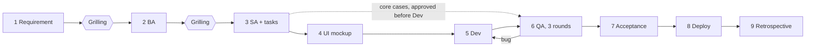

# AISDLC

A software development lifecycle in which an AI does the work of each stage and a human approves before the next one starts.

The AI (Claude Code) works as a team — PM, BA, SA, UI designer, Dev, QA. One person, or a few, set the problem, decide, and accept the result. At every hand-off the framework states **what comes next, how it is done, and who does it**.

The rules the AI follows are in [`CLAUDE.md`](CLAUDE.md), which Claude Code loads in every session. This file is the overview for people.

**Requires**: [Claude Code](https://claude.com/claude-code) and Node.js. The framework relies on Claude Code's skills, hooks, and `CLAUDE.md` loading.

**Status**: version 3.0. Used so far to build and run one production system. Treat it as a working method that is still being proven, and adapt it.

## Idea

**Tools adapt to people.** Software exists so working people do their own work better without learning more about computers. The side that learns is us: their work, their business, the real problem.

**Human-approved.** The AI proposes and builds; a human decides. The framework is built so that the human's decisions are few, clear, and recorded.

## Flow



| Stage | What happens | Output | The human approves |
|---|---|---|---|
| 1 Requirement | The human writes the requirement and names the tech stack | `BA/requirement.md` | That this is the requirement to analyse |
| Grilling | The AI asks about the real problem, gaps, ambiguity, conflicts, costly-to-change decisions, quality, and law — ordered by the cost of changing later | Answers | – |
| 2 BA | Analysis and acceptance criteria: "When …, the system must …" | `BA/BA_analysis.md` | The analysis and criteria |
| 3 SA | Database, APIs, screens; then tasks | `SA/SA_design.md`, `SA/tasks.md` | The design and the task list |
| 4 UI mockup | Main screens, accepted by the client | `UI_Mockup/` | The main screens |
| 5 Dev | Readiness check, then code task by task, test-first | `Dev/` | Tasks done, CI run, review result |
| 6 QA | Cases from the requirement → function → quality beyond function ([`process/nfr-baseline.md`](process/nfr-baseline.md)) | `QA/test_plan.md`, `QA/issues.md` | Core cases, the risk review, the QA report |
| 7 Acceptance | The human uses the system in each role | `APPROVALS.md` | The system, for release |
| 8 Deploy | Staging → smoke test → production, with restore and rollback drills | `deploy/README.md` | That it is live |
| 9 Retrospective | Which stage revised most, where bugs escaped | Proposed framework edits | Which edits to apply |

A system that is already live does not walk the whole line again: [`process/change.md`](process/change.md). Small jobs use the light level: [`process/levels.md`](process/levels.md).

## Rules that hold throughout

- **Stop for approval at the end of each stage.** Inside a stage the AI keeps working.
- **Every report ends with the hand-off block**: next · how · who · needs approval.
- **Every approval is recorded** in `APPROVALS.md` with the date, the document version, the approver's git user name, and the human's own words.
- **"Passed" comes from a command that ran** — and, where the project has CI, from the CI run on that commit.
- **Fix the source document** whenever a decision overrides an approved document.
- **Accepted risks are written down**, so nobody "fixes" intended behaviour.
- **The loop stops after three failed fixes** of the same issue, and waits for the human.
- **Some actions always need a human**: production deploys and data, secrets, deletion, messages to customers, spending ([`process/security.md`](process/security.md)).

## Getting started

1. Install Claude Code and Node.js, clone this repo, and open the folder in Claude Code.
2. Install the skills per [`SETUP.md`](SETUP.md).
3. Copy [`PROJECT.example.md`](PROJECT.example.md) to `PROJECT.md` and fill it in: the project folder, who the humans are, the language, the law that applies.
4. Put the requirement, with the tech stack, at `BA/requirement.md` in the project folder.
5. Tell Claude Code to start. Answer the grilling rounds — "as you propose" is a valid answer. Approve each stage, or give feedback to revise it.

To resume, open a new session and give the instruction. Claude Code reads the project's `PM_STATE.md` first and continues from the last checkpoint.

How you organise several projects is your choice. One way is a branch of this repo per project, each with its own `PROJECT.md` and extra skills, taking framework updates from `main`.

## File map

```
AISDLC/
├── CLAUDE.md            The core rules — loaded every session
├── PROJECT.example.md   Form for project specifics → copy to PROJECT.md
├── process/
│   ├── stages/          One file per stage: who · how · output · done when · approves · next
│   ├── grilling.md      How the AI questions the human before designing
│   ├── change.md        Changing a live system
│   ├── levels.md        Full and light pipeline levels
│   ├── nfr-baseline.md  Thirteen quality checks for every project
│   └── security.md      Secrets, real data, actions that need a human
├── templates/           Blank forms for every project document, and an example CI file
├── extensions/          Optional roles outside the pipeline
├── SETUP.md             Installing the skills, and why each was chosen
└── .claude/skills/      Skills the pipeline uses
```

Each project folder, outside this repo:

```
<project>/
├── PM_STATE.md    Current state — a checkpoint every time a stage finishes
├── APPROVALS.md   Record of every human approval
├── BA/            requirement.md · BA_analysis.md
├── SA/            SA_design.md · tasks.md
├── UI_Mockup/
├── Dev/
├── QA/            test_plan.md · issues.md
└── deploy/        README.md
```

## Glossary

| Term | Meaning |
|---|---|
| Grilling | The AI's mandatory questioning of the human before analysis ends and before design starts |
| Acceptance criterion | One sentence, "When …, the system must …", that is also one QA case |
| Core case | A test case for the main job of a role; approved by the human before development |
| Accepted risk | A limitation the human knowingly accepted; intended behaviour, not a bug |
| Revision round | One return to a stage because of feedback |
| Independent reviewer | A subagent that reviews risk areas without having seen the developer's conversation |
| Risk-review pack | A plain-language list of risk-area rules and ways to try breaking them, answered by a human |
| Hand-off block | The four lines ending every report: next · how · who · needs approval |

## Changing the framework

- Keep section numbers 0–8 and stage numbers 1–9 in `CLAUDE.md`; project documents and skills cite them.
- To change one stage, edit its file in `process/stages/`. Keep the six headings.
- Before editing, search for files that cite the part you are changing. After editing, check with `git diff`.
- Use the skill `writing-for-agents` when editing `CLAUDE.md`, a process file, or a skill.
- Record the change in [`CHANGELOG.md`](CHANGELOG.md) and bump the version in `CLAUDE.md`.
